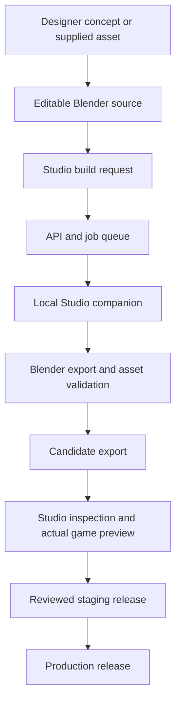

# StatOz platform architecture and deployment plan

Date: 8 November 2026  
Status: Proposed architecture for a brand-new setup

This plan describes a new platform. It does not represent infrastructure already
provisioned or authorize moving existing repositories, uploading assets, pushing
code or deploying applications.

## 1. Architecture decision

Use one GitHub organization and one private code monorepo, with independently
runnable applications and independent production releases.

The four products are:

| Product | Audience | Owns |
| --- | --- | --- |
| StatOz App, web and mobile | StatOz users | Accounts, sports features, profiles, collections and access to games |
| StatOz Games | Players | Game discovery, launching, player settings and delivery of game releases |
| StatOz Designer | Designers and content creators | Brand assets, graphics, mockups, promotional content and visual concepts |
| StatOz Game Studio | Game creators and developers | Scenes, asset assignments, animation previews, cameras, lighting, tuning and game builds |

The game engine is a shared library used by games and Studio. Each game has one
canonical project. Player hosts and creator tools consume that project through
explicit interfaces.

Assumption: the same owning team can access the whole codebase. If source access
must be restricted between teams, repository boundaries should follow those access
requirements. CODEOWNERS manages review ownership; it does not provide folder-level
read isolation.

## 2. GitHub organization and repository

Illustrative organization and repository: `StatOz/statoz-platform`.

```text
statoz-platform/
├── apps/
│   ├── web/                    StatOz web application
│   ├── mobile/                 Flutter Android/iOS application
│   ├── games-web/              Game catalogue and player interface
│   ├── designer/               Design and content tools
│   ├── game-studio/            Game authoring interface
│   └── api/                    Shared business API
│
├── games/                      All 15 canonical game projects
│   ├── cricketer/
│   ├── football-chess/
│   ├── holdover/
│   ├── hoop-legacy/
│   ├── longbow/
│   ├── open-golf/
│   ├── penalty-cup/
│   ├── pitch-duel/              FOT Duel
│   ├── pitch-rush/
│   ├── portfolio-formula/       Formula
│   ├── racer/
│   ├── rally-dash/
│   ├── rim-rush/
│   ├── vibe-basketball/
│   └── yorker/
│
├── packages/
│   ├── game-engine/
│   ├── game-host-sdk/
│   ├── game-catalog/
│   ├── contracts/
│   ├── design-tokens/
│   ├── ui-web/
│   └── asset-pipeline/
│
├── tools/
│   ├── blender/
│   └── studio-companion/
├── supabase/                   Migrations, policies and database tests
├── infra/                      Deployment configuration
├── docs/                       Architecture, workflows and operations
└── .github/
    ├── CODEOWNERS
    └── workflows/
        ├── ci.yml
        ├── preview.yml
        ├── staging.yml
        ├── release-app.yml
        ├── release-game.yml
        ├── release-mobile.yml
        └── database.yml
```

Use a JavaScript workspace manager and Turborepo for the JavaScript/TypeScript
dependency graph and build tasks. Flutter retains its own `pubspec.yaml`, lockfile
and toolchain; root automation invokes its checks explicitly.

The monorepo is the source of truth. Separate deployments do not require separate
copies of the engine, game code or design system.

## 3. Shared package responsibilities

| Package | Responsibility |
| --- | --- |
| `game-engine` | Lifecycle, scheduling, input, audio, rendering adapters, optional physics, resource ownership and reusable runtime services |
| `game-host-sdk` | Launch context, ready/error events, pause/resume, settings, save exchange, results and exit; browser implementation and a corresponding Flutter bridge |
| `game-catalog` | Game identifiers, capabilities, release metadata and compatible runtime entry points |
| `contracts` | Versioned API/message schemas, asset manifests and generated TypeScript/Dart data models |
| `design-tokens` | StatOz design values, with generated outputs for web and Flutter |
| `ui-web` | Reusable StatOz web components used by application shells and creator tools |
| `asset-pipeline` | Import, provenance checks, validation, export, immutable revisions and manifest generation |

Applications consume shared packages through public entry points. Games import
the engine and contracts; engine packages remain independent of individual games
and editor screens.

Each game owns its rules, AI, scenes, tuning, assets, save schema and tests. Games
retain their own visual identities. Shared StatOz interface foundations apply to
the application shells and creator tools.

## 4. Hosting and domain map

The domain names below are illustrative. Domain ownership and availability must be
established during setup.

| Component | Example address | Deployment target |
| --- | --- | --- |
| StatOz web | `statoz.com` | Vercel project for `apps/web` |
| StatOz Games | `games.statoz.com` | Separate Vercel project for `apps/games-web` |
| StatOz Designer | `designer.statoz.com` | Separate Vercel project for `apps/designer`, with creator access |
| StatOz Game Studio | `studio.statoz.com` | Separate Vercel project for `apps/game-studio`, with creator access |
| Shared API | `api.statoz.com` | Separate Vercel project for short API requests in `apps/api` |
| Playable game releases | `play.statoz.com` | Cloudflare Worker serving versioned runtime artifacts from R2 |
| Runtime assets | `assets.statoz.com` | Cloudflare R2 with CDN/custom-domain delivery |
| Android application | Google Play | Signed Flutter Android build |
| iOS application | App Store | Signed Flutter iOS build |
| Database and identity | Managed endpoints | Separate staging and production Supabase projects |

Vercel applications each have their own root directory, environment variables and
deployment configuration. Use separate staging and production projects where
needed to keep their credentials and deployment destinations explicit.

GitHub Actions is the deployment controller. Configure automatic provider Git
deployments consistently to prevent duplicate builds or an unintended production
deployment on every merge.

## 5. Identity, backend and data ownership

Start with Supabase PostgreSQL and Auth, with one production identity system used
by the products. Apply permissions for players, creators and administrators.
Each application maintains its own session handling against that identity system.

The shared API owns business operations such as:

- Account/profile operations and permissions.
- Account-scoped game progress and validated result handling.
- Game catalogues and release selection.
- Creator projects, asset metadata and build jobs.
- Release records and audit information.

Keep domain ownership explicit inside this backend. Use database policies to scope
access to the appropriate account, project and role. Administrative credentials
remain on trusted services.

Game simulation runs in the game runtime. An authoritative multiplayer simulation,
if introduced, would use a dedicated game-server deployment rather than ordinary
short API requests.

Database migrations live in Git and are tested in staging before production.
Backend contracts must remain compatible with supported older mobile and game
releases.

## 6. Browser and mobile game delivery

The web application and Games platform launch games through the host SDK. The
Flutter app uses the same message contract through a WebView host.

The host provides scoped launch context and exchanges lifecycle, progress and
result messages. Flutter retains its native interface and platform integration.
Sharing browser gameplay does not turn the TypeScript engine into a native Flutter
renderer.

Every host loads an explicit game release. A running match remains pinned to its
loaded runtime and asset revision. Game delivery, mobile compatibility and store
policy checks are part of release acceptance. Native application changes follow
the Android/iOS build and store-release process.

## 7. Asset ownership and storage

Use Git for code, scene data, export recipes, provenance and manifests. Use Git LFS
for large editable asset sources, including `.blend` files. Use R2 for generated
candidates and approved runtime artifacts.

Separate storage by environment and purpose:

| Storage area | Access and purpose |
| --- | --- |
| Editable source | Private creator/developer access, versioned with the project |
| Candidate exports | Authenticated preview access before approval |
| Staging runtime | Artifacts used by staging game releases |
| Production runtime | Approved immutable runtime files served to players |

Asset records include the original source, author, licence, verification evidence,
source hash, export recipe and toolchain version. Preserve original notices.

Publish game-ready GLB files, sprite atlases, textures and audio. Each game defines
asset-role contracts such as car wheel pivots, character rig names, animation
clips, sockets, dimensions and collision requirements.

## 8. Blender and Studio workflow

The Studio interface is a web deployment. Native file operations and Blender
execution belong to a companion running on the creator's computer.



The companion authenticates, retrieves jobs assigned to its project, operates on
its configured local workspace and uploads candidate artifacts. The job protocol
exposes specific asset operations rather than arbitrary shell commands.

The normal asset loop is:

1. Import a verified asset while preserving the original.
2. Edit and save its Blender source.
3. Export a 3D model or transparent 2D sprite atlas.
4. Validate file integrity, budgets and the game's asset-role contract.
5. Preview the candidate in actual gameplay.
6. Approve it for a staging game release.
7. Run gameplay, visual and device checks.
8. Publish an explicit production release.
9. Retain the previous compatible release for rollback.

Hosted rendering workers can be added when remote exports or render queues become
necessary. Long Blender jobs are separate from ordinary web/API request handling.

## 9. Environments and branches

| Environment | Trigger | Purpose and data |
| --- | --- | --- |
| Local | Developer starts the tools | Coding, local backend, Blender work and immediate previews |
| PR preview | Pull request | Temporary deployments of affected applications, using non-production data |
| Staging | Merge to protected `main` | Stable integration environment with staging services and credentials |
| Production | Explicit component release | A selected tested commit or approved immutable game artifact |

Use short-lived feature branches and pull requests into protected `main`.
Require appropriate status checks and reviews. Keep production credentials scoped
to production deployment workflows/environments.

Use GitHub Projects and labels to track product, game, engine and asset work.
CODEOWNERS assigns review responsibility to the appropriate paths. Available
private-repository protections and reviewer-based environment gates depend on the
GitHub plan.

Production domains stay stable. Staging can use addresses such as
`staging.statoz.com`, `games-staging.statoz.com` and
`studio-staging.statoz.com`; PR deployments use temporary preview URLs.

## 10. CI and deployment workflows

Use an always-running CI entry workflow that determines affected projects and
their consumers. It dispatches the relevant checks and reports one dependable
overall result.

| Change | Required impact checks |
| --- | --- |
| One game | That game's rules, runtime, assets and host integration |
| Shared engine | Every consuming game, plus engine compatibility and performance checks |
| Shared host SDK/contracts | Consuming web, mobile, Studio and game integrations |
| Shared web UI/tokens | Consuming web applications and generated Flutter values |
| Asset source/recipe | Provenance, export integrity, budgets, required rig/clip/socket checks and game preview |
| Backend/schema | API/database tests, policies and migration compatibility |
| Flutter application | Dart checks, relevant integration checks and Android/iOS builds |

Proposed workflow responsibilities:

- `ci.yml`: affected-project detection, lint, type checks, rules tests and builds.
- `preview.yml`: PR application previews and candidate game previews.
- `staging.yml`: deploy tested `main` to staging and run integration smoke checks.
- `release-app.yml`: explicitly release web, Games Web, Designer, Studio or API.
- `release-game.yml`: publish selected game artifacts and update the release catalogue.
- `release-mobile.yml`: signed builds, beta distribution and explicit store submission.
- `database.yml`: test and apply migrations in the appropriate environment.

Native iOS jobs use macOS runners. Android and browser/build jobs use suitable
separate runners. Cache dependencies and reusable build outputs according to their
toolchains.

Frontend production deployments use the selected commit and production
configuration. Environment-independent game artifacts can be promoted without
re-exporting or rebuilding their bytes.

## 11. Independent versions and releases

Applications, the engine and individual games have independent release versions.
Illustrative release tags:

```text
web-v1.3.0
designer-v0.4.0
studio-v0.2.0
mobile-v1.0.0
engine-v0.3.0
game-formula-v1.2.0
game-yorker-v1.1.0
```

A game release manifest records:

```text
gameId
gameVersion
engineVersion
hostProtocolVersion
assetRevision
saveSchemaVersion
sourceCommit
buildRevision
entryUrl
fileHashes
```

Publishing a game updates the environment's catalogue to select that verified
release. Immutable files have content/version-specific URLs and appropriate cache
headers. Catalogue pointers use a refresh policy suitable for release changes.

An engine change triggers checks for all consumers. Publishing the engine source
does not rewrite already released game artifacts; compatible new game builds are
released deliberately.

## 12. Operations and rollback

- Record the source commit and component version for every deployment.
- Tag errors and performance reports with application, game, engine and asset versions.
- Keep frontend rollback targets and previous game catalogue revisions available.
- Preserve compatibility with active game sessions and supported mobile versions.
- Use backwards-compatible database migrations; database recovery is a separate
  operation from changing a frontend deployment or catalogue pointer.
- Configure database backups, restore procedures, uptime checks and storage lifecycle rules.
- Retain files referenced by supported releases and offline clients when cleaning storage.

## 13. Implementation phases and acceptance

### Phase 1: Establish the foundation

Create the organization/repository, workspace boundaries, shared contracts and
CI entry workflow. Establish separate staging and production service accounts,
projects and credentials.

Acceptance: every application starts independently; package dependencies are
explicit; checks can identify affected consumers; preview work uses non-production data.

### Phase 2: Establish delivery and hosts

Deploy the web application, Games Web, creator-tool shells and API to staging.
Implement the browser and Flutter game-host contracts. Establish versioned runtime
storage and the game release catalogue.

Acceptance: one minimal game launches, pauses, saves and exits through both web
and Flutter hosts; staging deployments have identifiable source revisions.

### Phase 3: Prove the complete 3D asset workflow

Use Yorker or Formula as the first 3D pilot. Define one real asset-role contract
and connect Blender, the local companion, Studio preview and versioned releases.

Acceptance: original preserved; candidate validated; gameplay and physical-device
review completed; staging release promoted explicitly; rollback demonstrated.

### Phase 4: Prove the 2D workflow

Use Rally Dash as a 2D pilot with Blender-rendered transparent sprite assets.
Validate atlas frames, pivots, animation timing and runtime texture ownership.

Acceptance: the same candidate/review/release process works for 2D and 3D, with
gameplay behavior and device performance checked for each.

### Phase 5: Apply the process to all 15 games

Give every game its own definition, asset-role contracts, save compatibility,
acceptance checks and release records. Open Golf belongs in the same project
structure, including its remake and transition plan.

Acceptance: each game can be built, previewed, released and rolled back
independently through the shared engine/tooling foundation.

### Phase 6: Expand authoring capabilities

Add scene hierarchy editing, transforms, materials, lighting, cameras, animation
inspection and reusable project templates. Introduce hosted build/render workers
when creator workflow and demand justify them.

Acceptance: saved editor projects reproduce the same game scenes and asset
bindings in Studio, staging and released builds.

## 14. Reference documentation

- [Turborepo repository structure](https://turborepo.dev/docs/crafting-your-repository/structuring-a-repository)
- [Vercel monorepos](https://vercel.com/docs/monorepos)
- [Vercel Git deployment configuration](https://vercel.com/docs/project-configuration/git-configuration)
- [Supabase authentication](https://supabase.com/docs/guides/auth)
- [Supabase environment management](https://supabase.com/docs/guides/deployment/managing-environments?environment=production&queryGroups=environment)
- [Cloudflare R2 custom domains](https://developers.cloudflare.com/r2/buckets/public-buckets/)
- [Cloudflare Workers with R2](https://developers.cloudflare.com/r2/api/workers/workers-api-usage/)
- [GitHub deployment environments](https://docs.github.com/en/actions/reference/workflows-and-actions/deployments-and-environments)
- [GitHub CODEOWNERS](https://docs.github.com/en/repositories/managing-your-repositorys-settings-and-features/customizing-your-repository/about-code-owners)
- [Official Flutter WebView package](https://pub.dev/packages/webview_flutter)
